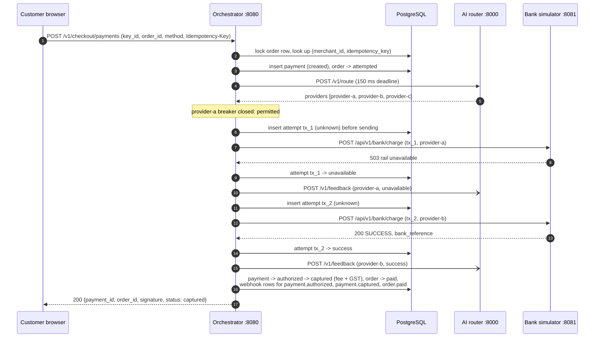
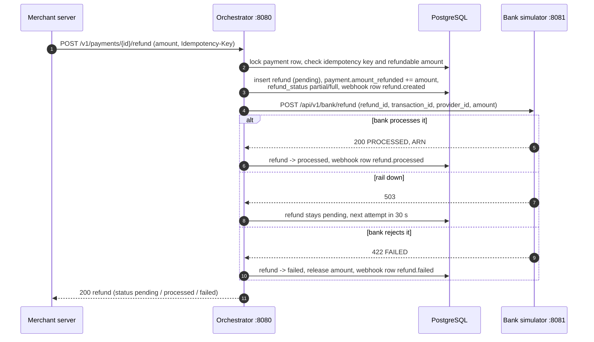
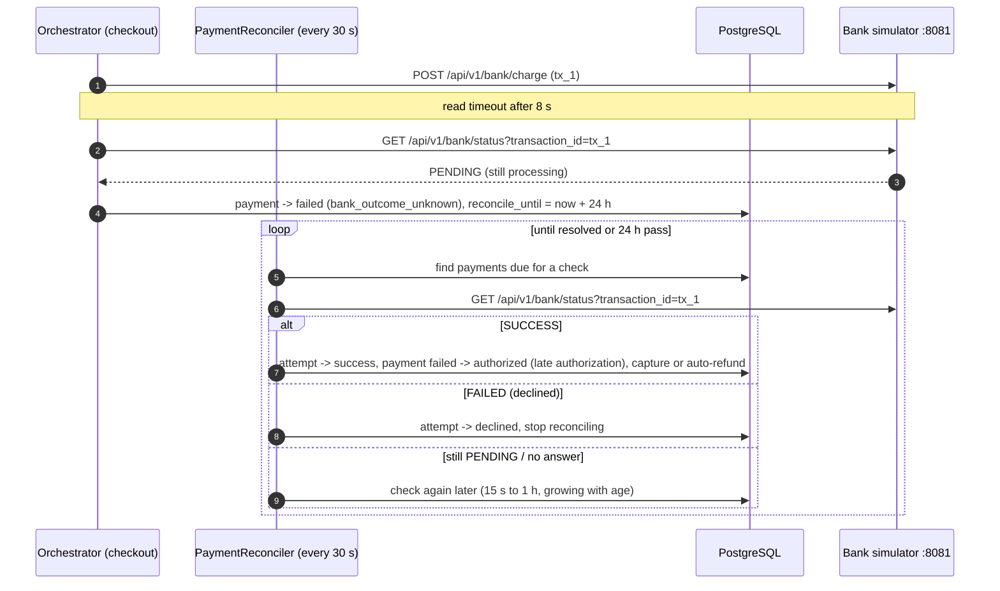

# System Architecture

## 1. Overview

The gateway is four small services plus PostgreSQL. The **payment orchestrator** owns all state and all money movement; the other services either simulate the outside world (the **bank simulator**), advise it (the **AI router**) or let a person drive it (the **operations dashboard**).

```text
                      ┌──────────────────────────────────────────────┐
                      │ Operations dashboard (Next.js 16, :3000)     │
                      │ browser app; acts as one sandbox merchant    │
                      └───────┬──────────────────┬───────────────┬───┘
            /v1 (Basic auth), │                  │ chaos API,    │ /health, /v1/stats,
            /v1/checkout, /ops│                  │ charge/status │ /v1/route, /v1/model/reload
                              ▼                  │               │
 Merchant server ──/v1──► ┌──────────────────────┴───────┐       │
 Customer browser ──────► │ Payment orchestrator         │       │
   (checkout.js,          │ Java 17, Spring Boot 3.5     │       │
    /v1/checkout)         │ :8080                        │       │
                          │  - merchant API, checkout    │       │
                          │  - routing + circuit breakers│       │
                          │  - refunds, reconciliation   │       │
                          │  - webhook dispatcher        │       │
                          └──┬─────────┬──────────┬──────┘       │
                  JPA / JDBC │         │ HTTP     │ HTTP         │
                             ▼         ▼          ▼              ▼
                ┌─────────────────┐ ┌──────────────────┐ ┌──────────────────────┐
                │ PostgreSQL 16   │ │ Bank simulator   │ │ AI router            │
                │ :5432           │ │ Go, :8081        │ │ Python/FastAPI, :8000│
                │ 7 tables        │ │ 3 rails + chaos  │ │ bandit + LR model    │
                └─────────────────┘ └──────────────────┘ └──────────────────────┘

                Redis 7 (:6380) is started by docker-compose but used by no service.
```

The orchestrator also sends webhooks to merchant URLs and serves three static files: the demo store (`/`), `checkout.js` and the hosted checkout frame (`/checkout/frame.html`).

---

## 2. Components and ports

| Component | Port | Technology | Runs as | Responsibility |
| :--- | :--- | :--- | :--- | :--- |
| **Payment orchestrator** | 8080 | Java 17, Spring Boot 3.5, Spring Data JPA (Hibernate 6.6), Resilience4j 2.3 | JVM process (`./mvnw spring-boot:run`) | Merchant API, hosted checkout, payment state machine, routing and failover, circuit breakers, refunds, reconciliation, webhook outbox and dispatcher, analytics, operator endpoints. |
| **Bank simulator** | 8081 | Go 1.22, standard library `net/http` | Go process (`go run .`) | Three rails with configurable success rate, latency and kill switch; in-memory ledger of charges and refunds; status enquiry; chaos API. |
| **AI router** | 8000 | Python 3.12, FastAPI, Uvicorn, scikit-learn | Uvicorn process | Orders the candidate rails per payment (discounted Thompson sampling, optionally blended with a logistic-regression model); learns from attempt feedback. |
| **Operations dashboard** | 3000 | Next.js 16, React 19, TypeScript, Tailwind CSS | Node process (`npm run dev`) | Browser console for test mode. Calls the three services directly from the browser. |
| **PostgreSQL** | 5432 | PostgreSQL 16 (Alpine image) | Docker container `payment_postgres` | System of record for the orchestrator. |
| **Redis** | 6380 → 6379 | Redis 7 (Alpine image) | Docker container `payment_redis` | Reserved for a later phase (velocity limits). Not used. |

The orchestrator is the only component with a database. The bank simulator and AI router keep their state in memory and start empty after a restart (except a trained model, which the AI router loads from disk).

---

## 3. Inside the orchestrator

Package `com.gateway.orchestrator` in `services/payment-orchestrator/src/main/java`:

| Package | Contents |
| :--- | :--- |
| `api` | REST controllers: `MerchantController`, `OrderController`, `PaymentController`, `RefundController`, `WebhookController`, `AnalyticsController`, `CheckoutController` (public, key id only), `OpsController` (operator, unauthenticated). |
| `service` | `CheckoutService` (customer payment flow), `PaymentService` (payment state machine, capture, late authorization), `PaymentOrchestratorService` (rail-by-rail routing with circuit breakers), `RoutingAdvisor` (AI router client), `BankSimulatorClient` (classifies every bank answer), `RefundService` (refunds, retries, automatic refunds), `PaymentReconciler`, `WebhookService` (outbox writes), `WebhookDispatcher` (delivery), `AnalyticsService`, `FeeCalculator`, `EntityMapper`. |
| `domain` | JPA entities `Merchant`, `PaymentOrder` (table `orders`), `Payment`, `Transaction` (one rail attempt), `Refund`, `WebhookEndpoint`, `WebhookDelivery`, and their status enums. |
| `repository` | Spring Data repositories, including pessimistic-lock (`SELECT … FOR UPDATE`) finders. |
| `security` | `ApiKeyAuthFilter` (Basic auth), `SecretCipher` (AES-256-GCM), `WebhookUrlGuard` (SSRF protection). |
| `config` | `GatewayProperties` (`gateway.*` settings), `CorsConfig`, `SchedulingConfig`, HTTP client setup. |
| `support` | Id generation, list parameters, signatures, validators. |

Design rule: **no database transaction is held open while a bank is being called.** Starting a payment, recording each attempt and applying the outcome are separate short transactions, so a slow bank never holds a row lock.

---

## 4. Inter-service contracts

All services speak JSON over HTTP with snake_case field names.

### Orchestrator → bank simulator

| Call | When | Notes |
| :--- | :--- | :--- |
| `POST /api/v1/bank/charge` | Each rail attempt | Body: `transaction_id` (the attempt's `tx_…` id), `provider_id`, `amount` **in rupees** (decimal), `currency`, `payment_method` (`UPI`, `CARD`, `NETBANKING`), `customer_vpa`, `card_last4`, `bank_code`. |
| `GET /api/v1/bank/status?transaction_id=` | After an unclear answer, and by the reconciler | Returns the recorded charge (`PENDING` while still processing) or 404 if the bank never received it. |
| `POST /api/v1/bank/refund` | Each refund attempt | Body: `refund_id`, `transaction_id` (the charge being refunded), `provider_id`, `amount` in rupees, `currency`. The simulator de-duplicates by `refund_id`. |

Timeouts: 2 s to connect, 8 s to read (`gateway.routing.connect-timeout`, `read-timeout`). Every response is classified by `BankSimulatorClient` into one of: `SUCCESS`, `DECLINED`, `UNAVAILABLE` (definitely not processed), `UNKNOWN` (may have been processed) and, for status enquiries, `NOT_FOUND`. See [failover rules](02-state-machine-and-flows.md#5-routing-and-failover).

### Orchestrator → AI router

| Call | When | Notes |
| :--- | :--- | :--- |
| `POST /v1/route` | Once per payment, before the first attempt | Body: `providers` (configured rails), `payment_method`, `amount` (paise), `currency`. Hard deadline 150 ms (`gateway.routing.ai.timeout`); on any error or timeout the configured order is used. |
| `POST /v1/feedback` | After each attempt that was actually sent | Body: `provider`, `payment_method`, `outcome` (`success`, `declined`, `unavailable`, `unknown`), `amount`, `latency_ms`. Fire-and-forget; failures are ignored. Rails skipped by an open circuit breaker are not reported. |

### Dashboard → services

The dashboard runs in the browser and calls each service directly, using the URLs in `NEXT_PUBLIC_ORCHESTRATOR_URL`, `NEXT_PUBLIC_BANK_SIMULATOR_URL` and `NEXT_PUBLIC_AI_ROUTER_URL`. The complete list of calls is in `services/frontend/src/lib/gateway.ts`:

* **Orchestrator:** `POST /v1/merchants` (sandbox signup), `GET /v1/merchants/me`, orders, payments, attempts, capture, refunds, `GET /v1/analytics`, webhooks and deliveries (all with Basic auth); `POST /v1/checkout/payments` (key id only); `GET /ops/circuit-breakers` and `POST /ops/circuit-breakers/{providerId}/reset`.
* **Bank simulator:** `/api/v1/chaos/*`, plus `POST /api/v1/bank/charge` and `GET /api/v1/bank/status` for direct rail tests that bypass the orchestrator.
* **AI router:** `GET /health`, `GET /v1/stats`, `POST /v1/route` (playground), `POST /v1/model/reload`.

Because these are cross-origin browser calls, the orchestrator and AI router send CORS headers for the configured dashboard origins (`GATEWAY_CORS_ALLOWED_ORIGINS`, `AI_ROUTER_CORS_ORIGINS`); the bank simulator allows any origin.

### Orchestrator → merchant webhook URLs

`POST` with the event envelope as the body and headers `X-Gateway-Signature`, `X-Gateway-Event-Id`, `X-Gateway-Event`. See [webhooks](02-state-machine-and-flows.md#10-webhooks-outbox-and-delivery).

---

## 5. Sequence diagrams

### A. Checkout payment with failover

The customer pays an order through `checkout.js` (or the dashboard). In this example the AI router suggests `provider-a` first, `provider-a`'s breaker is closed but the rail is down, and `provider-b` approves.



If `provider-a`'s breaker had been open, step 6 onwards would instead record an attempt with `response_code` `CB_OPEN` and latency 0, send nothing to the bank and no feedback to the router, and go straight to `provider-b`.

### B. Refund



### C. Reconciling an unknown outcome



---

## 6. Background jobs

All run inside the orchestrator on a scheduler with 4 threads (`spring.task.scheduling.pool.size`).

| Job | Class | Interval | What it does |
| :--- | :--- | :--- | :--- |
| Webhook dispatcher | `WebhookDispatcher` | 1 s, and immediately when a send finishes | Claims due deliveries endpoint by endpoint (round robin, at most 2 in flight per endpoint and 4 per merchant, 16 senders), signs and posts them, records the result, schedules retries and pauses failing endpoints. |
| Refund retries | `RefundService.retryDueRefunds` | 5 s | Re-sends `pending` refunds whose next attempt is due. |
| Automatic refunds | `RefundService.refundUncapturableAuthorizations` | 30 s | Refunds `authorized` payments whose order was paid by another payment, or that are older than the 5-day capture window. |
| Reconciler | `PaymentReconciler.reconcileDue` | 30 s | Asks the bank about `failed` payments with an unknown outcome, and settles `created` payments older than 2 minutes (a checkout that died mid-flight). |

These jobs assume **one orchestrator instance**. Running several would need `SKIP LOCKED`-style claiming for the dispatcher and coordination for the other jobs.

---

## 7. Security model

| Surface | Protection |
| :--- | :--- |
| Merchant API (`/v1/**`) | HTTP Basic auth with `key_id:key_secret`, checked in `ApiKeyAuthFilter` with a constant-time comparison. Exceptions: `POST /v1/merchants` (signup) and `/v1/checkout/**`. |
| Checkout API (`/v1/checkout/**`) | Public, identified by the merchant's `key_id` only. The result is signed with `HMAC_SHA256(order_id + "|" + payment_id, key_secret)`; the merchant must verify it server-side. |
| Operator API (`/ops/**`) | **No authentication.** Expose only on a trusted network, like the bank simulator's chaos API and the AI router. |
| Secrets at rest | Merchant key secrets and webhook secrets are encrypted with AES-256-GCM using `GATEWAY_MASTER_KEY`. Without it a built-in development key is used and a warning is logged. |
| Card data | Card number and CVV are validated (Luhn, expiry, CVV length) and discarded; only the last four digits and the network are stored. |
| Webhook targets | `WebhookUrlGuard` refuses URLs that resolve to loopback, private, link-local and other non-public addresses, at registration and before every delivery, unless `GATEWAY_WEBHOOKS_ALLOW_PRIVATE_NETWORK=true`. |
| Browser access | CORS only for the configured dashboard origins, on `/v1/**` and `/ops/**`, with methods `GET`, `POST`, `DELETE` and headers `Authorization`, `Content-Type`, `Idempotency-Key`. |
| Dashboard keys | The dashboard stores its sandbox merchant's key secret in `localStorage`. Acceptable for a local test console only. |

Known gaps are listed in the README's *Limitations* section (open signup, no rate limiting, DNS rebinding, single instance).
