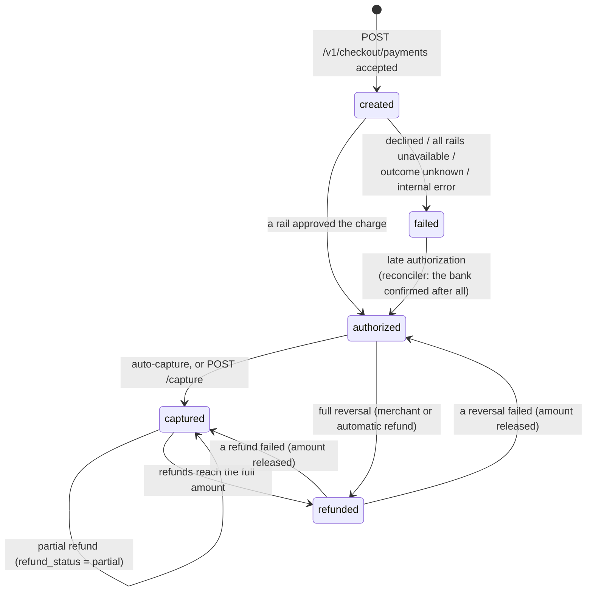

# State Machines and Flows

Every rule below is taken from the orchestrator's code (`services/payment-orchestrator`). Class names are given so you can check them.

## 1. Order lifecycle

```text
created ──(first payment attempt)──► attempted ──(a payment is captured)──► paid
```

| Status | Meaning |
| :--- | :--- |
| `created` | Created by the merchant (`POST /v1/orders`). Fixes `amount` and `currency`, and whether payments are captured automatically (`payment_capture`, default `true`). |
| `attempted` | At least one payment has been started. Failed payments leave the order `attempted`; the customer can try again with a new payment. |
| `paid` | A payment was captured. `amount_paid` is increased by the payment amount. A paid order accepts no new payments. |

`attempts` counts the payments started for the order.

---

## 2. Payment lifecycle



| From | To | Trigger | Side effects |
| :--- | :--- | :--- | :--- |
| none | `created` | `CheckoutService.pay` → `PaymentService.start`. The order is locked; it must belong to the merchant, not be `paid`, and have no other payment in `created` younger than 2 minutes. | Order → `attempted`, `attempts + 1`. |
| `created` | `authorized` | A rail approved the charge (`PaymentOrchestratorService.authorize` returned authorized). | `provider`, `bank_reference` and the provider transaction id are stored. Event `payment.authorized`. |
| `authorized` | `captured` | Immediately if the order has `payment_capture: true` and is not already paid; otherwise `POST /v1/payments/{id}/capture` with the exact amount and currency. | `captured = true`, `fee` (2% + GST) and `tax` set, order `amount_paid += amount`, order → `paid`. Events `payment.captured` and `order.paid`. |
| `created` | `failed` | Routing ended without approval. | `error_code`, `error_description`, `error_source`, `error_step`, `error_reason` set. Event `payment.failed`. If the bank may have charged the customer, `reconcile_until` is set (see [reconciliation](#7-reconciliation)). |
| `failed` or `created` | `authorized` | Late authorization: the reconciler's status enquiry finds the charge approved. | Same as a normal authorization; captured if auto-capture is on and the order is not already paid, otherwise refunded automatically. |
| `authorized` / `captured` | `captured`, `refunded` | A refund is created; its amount is reserved at once. | `amount_refunded` increases; `refund_status` becomes `partial` or `full`; status becomes `refunded` when the full amount is reserved. |
| `refunded` / `captured` | `captured` / `authorized` | A refund ends `failed`. | Its amount is released and `refund_status` / `status` are recomputed. |

The payment's status reflects refunds **as soon as they are created**, including `pending` ones, because their amounts are reserved. Use `GET /v1/payments/{id}/refunds` to see which refunds the bank has actually processed.

### Failure reasons

| Situation | `error_code` | `error_source` | `error_reason` | Checkout HTTP status |
| :--- | :--- | :--- | :--- | :--- |
| Bank declined (response code `51`) | `BAD_REQUEST_ERROR` | `bank` | `insufficient_funds` | 400 |
| Bank declined (any other code) | `BAD_REQUEST_ERROR` | `bank` | `payment_declined` | 400 |
| Every rail unavailable or skipped | `GATEWAY_ERROR` | `gateway` | `all_providers_unavailable` | 502 |
| No usable answer from the bank | `GATEWAY_ERROR` | `bank` | `bank_outcome_unknown` | 502 |
| Unexpected error while routing | `SERVER_ERROR` | `gateway` | `server_error` | 502 |

`error_step` is `payment_authorization` in every case. The simulator always declines with response code `51`, so simulated declines show `insufficient_funds`. The checkout error's `metadata` carries the `payment_id` and `order_id`.

---

## 3. Refund lifecycle

```text
pending ──(bank confirms)──────────────────────► processed
   │
   ├──(bank rejects)───────────────────────────► failed      amount released
   ├──(rail down / no answer)── retry ──► pending (again)
   └──(rail down for every attempt, and no attempt ever had an unclear answer)──► failed
```

| Rule | Detail (`RefundService`) |
| :--- | :--- |
| What can be refunded | `captured` payments: any amount up to the unrefunded remainder (default: all of it). `authorized` payments: only the full amount (a reversal; no fee was charged). Anything else is refused with 400. |
| Reservation | The payment row is locked, the refund is inserted as `pending`, and `amount_refunded` is increased in the same transaction. Concurrent refunds therefore cannot exceed the payment. Event `refund.created`. |
| First attempt | Sent to the rail that took the payment straight after the reservation is committed. |
| Bank confirms | `processed`, `acquirer_data.arn` set. Event `refund.processed`. |
| Bank rejects | `failed`, `failure_reason` set, reservation released. Event `refund.failed`. |
| Rail down or no answer | Stays `pending`; retried every 30 s, up to 10 attempts. |
| Out of attempts | If any attempt got no usable answer, the bank might have paid it out, so the refund **stays `pending`** and is retried hourly (logged as needing attention). Otherwise it becomes `failed` and the amount is released. |
| Bank-side safety | The simulator de-duplicates by `refund_id`, so a retry never pays out twice, even when two retries race. |

---

## 4. Idempotency and concurrency

### The `Idempotency-Key` header

Accepted on `POST /v1/checkout/payments` and `POST /v1/payments/{id}/refund`. Optional; 1 to 64 characters when present.

| Property | Behaviour |
| :--- | :--- |
| Scope | Per merchant. Payments and refunds are separate namespaces. |
| Enforcement | Unique indexes on `payments (merchant_id, idempotency_key)` and `refunds (merchant_id, idempotency_key)`. The database, not application memory, guarantees there is never a second row with the same key. |
| Payment replay, same order | Returns the first payment's outcome: the same `payment_id` and `signature` if it succeeded, the same error (with `metadata.payment_id`) if it failed. Nothing is sent to a bank again. |
| Payment replay while the first is still routing | HTTP 409: `A payment with this Idempotency-Key is still being processed.` |
| Same key, different order or payment | HTTP 400 (`field: idempotency_key`). |
| Refund replay, same payment | Returns the existing refund as it is now; no second bank call. |

### Concurrency guards

1. **Order row lock.** `PaymentService.start` loads the order with `SELECT … FOR UPDATE`, then looks up the idempotency key, checks the order is not paid and checks for another in-flight payment, then inserts. Two simultaneous requests for one order are therefore handled one after the other.
2. **In-flight window.** While a payment for an order is `created` and younger than 2 minutes, a new payment for that order (with a different or no key) gets HTTP 409. After 2 minutes the payment is treated as abandoned and the reconciler settles it.
3. **Unique index backstop.** If two requests with the same key race on different orders, the second insert violates the unique index and gets HTTP 409 (`The request conflicts with an existing resource. Retry the request.`).
4. **Payment row lock** for capture, refunds and every state change applied after routing.

No database transaction is held open while a bank is responding; the locks above cover only the short transactions before and after.

---

## 5. Routing and failover

`PaymentOrchestratorService.authorize` tries the rails in the order given by the AI router, or the configured order `provider-a, provider-b, provider-c` without it.

```text
for each rail in the plan:
    if the rail's circuit breaker refuses:      record attempt (unavailable, CB_OPEN, 0 ms); next rail
    record attempt as UNKNOWN                   # write-ahead: committed before the charge is sent
    send the charge
    if the answer is UNKNOWN: status enquiry on the same rail; use its answer if it is approved/declined
    update the circuit breaker, the attempt row, and the AI router (feedback)
    SUCCESS     -> payment authorized, stop
    DECLINED    -> payment failed, stop
    UNKNOWN     -> payment failed (bank_outcome_unknown), stop, reconcile later
    UNAVAILABLE -> next rail
all rails unavailable -> payment failed (all_providers_unavailable)
```

### How a bank answer is classified (`BankSimulatorClient`)

| Bank answer | Outcome | Fail over? |
| :--- | :--- | :--- |
| Connection refused, unknown host, no route | `UNAVAILABLE` | Yes |
| HTTP 503 (rail killed) | `UNAVAILABLE` | Yes |
| HTTP 4xx without a bank status (e.g. unknown rail) | `UNAVAILABLE` | Yes |
| HTTP 4xx with a bank status (a decline) | `DECLINED` | No |
| 2xx with status `SUCCESS` (or `PROCESSED` for refunds) | `SUCCESS` | n/a |
| 2xx with status `PENDING` | `UNKNOWN` | No |
| Read timeout, connection reset, other 5xx (502, 504), unreadable body | `UNKNOWN` | No |

The asymmetry is deliberate: only an answer that proves the bank **did not** process the charge allows sending it to another rail. Anything that might have reached the bank stops routing, because a second rail could charge the customer again.

### Attempt records

Each attempt is a row in `transactions` (exposed as `GET /v1/payments/{id}/attempts`) with `status` `success`, `declined`, `unavailable` or `unknown`, the bank's `response_code`, `message`, `bank_reference` and `latency_ms`. The payment's `attempts` field counts every rail considered, including rails skipped by a breaker.

---

## 6. Circuit breakers

One Resilience4j circuit breaker per rail, named after the rail. Configuration (`resilience4j.circuitbreaker.instances` in `application.yml`):

| Setting | provider-a | provider-b | provider-c |
| :--- | :--- | :--- | :--- |
| `slidingWindowSize` (count-based) | 10 | 10 | 10 |
| `minimumNumberOfCalls` | 5 | 5 | 5 |
| `failureRateThreshold` | 50% | 50% | 50% |
| `waitDurationInOpenState` | 5 s | 5 s | 5 s |
| `permittedNumberOfCallsInHalfOpenState` | 3 | 10 (default) | 10 (default) |

```text
CLOSED ──(≥ 50% of the last 10 calls failed, after ≥ 5 calls)──► OPEN
OPEN ──(first payment after 5 s)──► HALF_OPEN ──(trial calls succeed)──► CLOSED
                                         └──────(trial calls fail)─────► OPEN
any state ──(POST /ops/circuit-breakers/{providerId}/reset)──► CLOSED, statistics cleared
```

| Rule | Detail |
| :--- | :--- |
| Counts as failure | `UNAVAILABLE` or `UNKNOWN` outcomes, and unexpected exceptions during the call. |
| Counts as success | `SUCCESS` **and `DECLINED`**: the rail answered; the customer's bank said no. |
| Not counted | Nothing was sent (for example the attempt row could not be written): the permission is released. |
| When open | The rail is skipped without sending the charge, which is always safe to fail over from. The skip is stored as an attempt with status `unavailable`, `response_code` `CB_OPEN`, message `Circuit breaker open: rail skipped without sending the charge` and latency 0. No feedback is sent to the AI router for it. |
| Transition to half-open | Happens when a payment asks for permission after the wait, not on a timer. On an idle system the state stays `OPEN` until the next payment. |
| Inspect / reset | `GET /ops/circuit-breakers`, `POST /ops/circuit-breakers/{providerId}/reset` (unauthenticated; trusted network only). |
| Turn off | `GATEWAY_CIRCUIT_BREAKER_ENABLED=false`: every rail in the plan is always tried. |
| Scope | In memory, per orchestrator instance; all breakers start `CLOSED` after a restart. |

---

## 7. Reconciliation

`PaymentReconciler` runs every 30 seconds and picks up two kinds of payment:

| Kind | Selected when | What happens |
| :--- | :--- | :--- |
| Unknown outcome | `failed` with `reconcile_until` set (reason `bank_outcome_unknown` or `server_error`), and `reconcile_after` is due | For each attempt still `unknown`, a status enquiry. |
| Abandoned checkout | `created` for more than 2 minutes (the checkout request died, e.g. the process crashed) | Same enquiries, then the payment is completed as authorized or failed. |

Rules for each enquiry:

* `SUCCESS`: the attempt becomes `success` and the payment a **late authorization** (`failed → authorized`), then it is captured as usual, or refunded automatically if the order was meanwhile paid by another payment.
* `FAILED` (declined): the attempt becomes `declined`.
* `PENDING` or no usable answer: still unknown; check again after a quarter of the payment's age, between 15 seconds and 1 hour.
* `NOT_FOUND`: the simulator records every charge as `PENDING` the moment it arrives, so "not found" means the charge never reached it. This is only accepted as final at the end of the window, in case the bank's records lag (the simulator's ledger is in memory and is lost on restart).

When every attempt is resolved and none succeeded, the gateway stops reconciling. If the 24-hour window (`gateway.reconciliation.window`) ends with an attempt still unresolved, it stops and logs an error asking for manual reconciliation.

---

## 8. AI routing

`RoutingAdvisor` (orchestrator) and `services/ai-router` (Python).

1. Before the first attempt, the orchestrator sends `POST /v1/route` with the configured rails, the payment method, the amount in paise and the currency, and waits at most 150 ms.
2. The router scores each rail:
   * It draws a sample from the rail's Beta(α, β) belief for that payment method (Thompson sampling).
   * If a trained model is loaded, `score = w × P_model + (1 − w) × sample` with `w = AI_ROUTER_MODEL_WEIGHT` (0.3); otherwise `score = sample`.
   * It returns the rails sorted by score, plus `scores`, `expected_success`, `strategy` (`thompson_sampling` or `thompson_sampling+model`) and `model_version`.
3. The orchestrator keeps only rails it has configured, drops duplicates, appends any configured rail the router left out, and logs the strategy. On a timeout, an error or a non-200 answer it uses the configured order (`strategy: static`) and logs a warning at most once a minute.
4. After each attempt that was actually sent, it posts `POST /v1/feedback` with the outcome, without waiting for an answer.

How the bandit learns (`app/bandit.py`):

* One arm per (rail, payment method), starting at Beta(1, 1) ("unknown").
* An outcome counts as a success only if it is `success`. Declines, unavailable and unknown outcomes all count against the rail: the router estimates how often a rail **approves**, which is a different question from the circuit breaker's "is the rail up".
* Before each update the existing evidence is discounted by `AI_ROUTER_DISCOUNT` (0.98), so a busy arm reflects roughly its last 50 results.
* Evidence also decays over time with a half-life of `AI_ROUTER_HALF_LIFE_SECONDS` (120 s), so a rail that lost its traffic drifts back towards "unknown", is explored again and can win its traffic back.

The optional model is a scikit-learn logistic regression over one-hot rail and method, their interaction, log-scaled amount and the hour of day encoded on a circle (in `AI_ROUTER_TIMEZONE`). `train.py` trains it from a CSV of past attempts (exported from the `transactions` table or generated by `generate_data.py`) and reports test accuracy and AUC; `POST /v1/model/reload` loads a new version without a restart.

The router's beliefs live in memory per router instance and are lost on restart.

---

## 9. Automatic refunds

`RefundService.refundUncapturableAuthorizations` runs every 30 seconds and refunds, in full, every `authorized` payment that can no longer be captured:

* its order was paid by another payment (for example a late authorization arrived after the customer paid again), or
* it is older than the capture window (`gateway.payments.capture-window`, 5 days).

The refund carries `notes.reason` = `order_paid_by_another_payment` or `not_captured_within_capture_window`. A payment with a refund in progress or done is skipped; if its last automatic refund failed, it is tried again after an hour.

---

## 10. Webhooks: outbox and delivery

### Events

| Event | Raised when | Payload entities |
| :--- | :--- | :--- |
| `payment.authorized` | A payment is authorized (including a late authorization) | `payment` |
| `payment.captured` | A payment is captured | `payment` |
| `order.paid` | A payment is captured and the order becomes paid | `payment`, `order` |
| `payment.failed` | A payment becomes `failed` | `payment` |
| `refund.created` | A refund is created (amount reserved) | `refund`, `payment` |
| `refund.processed` | The bank confirms a refund | `refund`, `payment` |
| `refund.failed` | A refund fails | `refund`, `payment` |

### Outbox

`WebhookService.publish` must run inside the transaction that changed the entity (`Propagation.MANDATORY`). It writes one `webhook_deliveries` row per subscribed, active endpoint, all sharing one `evt_…` event id. The event is stored if and only if the change commits, so a crash can neither lose an event nor send one for a change that was rolled back.

### Delivery (`WebhookDispatcher`)

| Rule | Value |
| :--- | :--- |
| Request | `POST` to the endpoint URL, body = event envelope, headers `X-Gateway-Signature` (hex HMAC-SHA256 of the raw body with the endpoint's secret), `X-Gateway-Event-Id`, `X-Gateway-Event`, `User-Agent: AI-Payment-Gateway-Webhooks/1.0`. |
| Success | Any 2xx within 5 seconds. Delivery → `delivered`, endpoint marked healthy. |
| Failure | Non-2xx, timeout, connection error or a URL that now resolves to a blocked address. |
| Retries | Up to 8 attempts; backoff 5 s, 10 s, 20 s, … capped at 1 hour. Then the delivery is `failed`. |
| Endpoint pause | After a failure the whole endpoint is paused with the same growing backoff, so its other queued events wait without spending attempts, and it is probed again when the pause ends. |
| Fairness | Endpoints are served least recently claimed first, at most 2 deliveries in flight per endpoint, 4 per merchant, 16 overall. |
| Deleting an endpoint | Its pending deliveries are marked `failed` (`Webhook endpoint was deleted`). |
| Ordering | Not guaranteed; deliveries may also repeat. Receivers should de-duplicate by `X-Gateway-Event-Id` and act on the entity's `status`. |

A delivery is `pending`, `delivered` or `failed`; `GET /v1/webhooks/{id}/deliveries` shows the most recent ones with attempts, last response code and last error.
