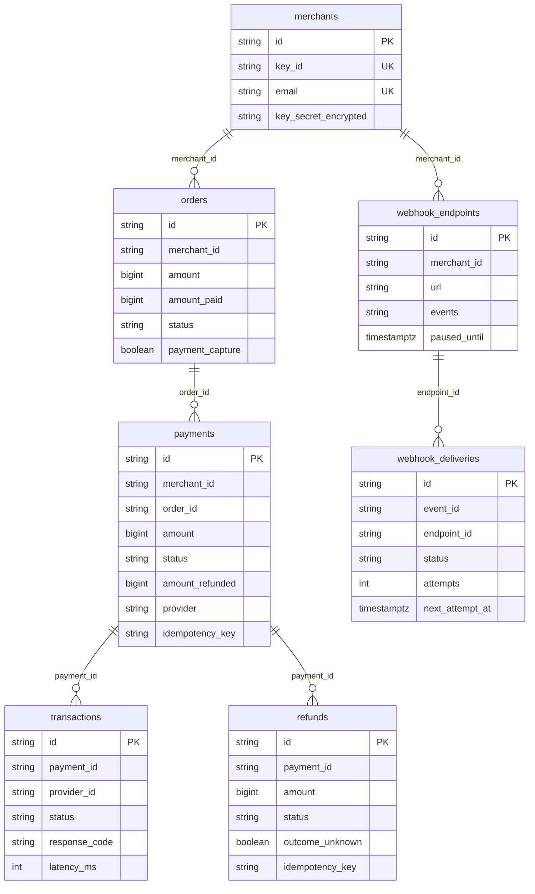

# Database Schema

## 1. Overview

The payment orchestrator is the only service with persistent state. It uses one PostgreSQL 16 database (`payment_db` by default, or any database you point `SPRING_DATASOURCE_URL` at) with seven tables, defined as JPA entities in `services/payment-orchestrator/src/main/java/com/gateway/orchestrator/domain/`:

| Table | Entity | Holds |
| :--- | :--- | :--- |
| `merchants` | `Merchant` | Merchant accounts and their (encrypted) API key secrets. |
| `orders` | `PaymentOrder` | Orders created by merchants before checkout. |
| `payments` | `Payment` | Customer payments against orders: state, instrument details, fees, errors, reconciliation timers. |
| `transactions` | `Transaction` | One row per rail attempt while routing a payment (the failover audit trail). |
| `refunds` | `Refund` | Refunds of payments, with retry state. |
| `webhook_endpoints` | `WebhookEndpoint` | Merchant webhook URLs, encrypted secrets, subscriptions and health. |
| `webhook_deliveries` | `WebhookDelivery` | The webhook outbox: one row per event per endpoint, with delivery state. |

Conventions:

* **Money** is stored as `bigint` paise. There are no floating-point or `numeric` amounts.
* **Ids** are `varchar(64)` strings with a type prefix (`acc_`, `order_`, `pay_`, `tx_`, `rfnd_`, `wh_`, `whd_`; events use `evt_`).
* **Enums** are stored by name in upper case (`CAPTURED`, `PENDING`); the API returns them in lower case.
* **Timestamps** are Java `Instant` values, stored as PostgreSQL `timestamp with time zone`.
* **Relationships are by id only.** The entities hold plain id columns (`merchant_id`, `order_id`, `payment_id`, …) and no foreign key constraints are declared; the application enforces ownership (every query is scoped by `merchant_id`).

Tables and columns are created and extended by Hibernate (`spring.jpa.hibernate.ddl-auto: update`). Column types below are as declared on the entities; run `\d <table>` in `psql` to see the exact definitions Hibernate generated.



---

## 2. Tables

### `merchants`

| Column | Type | Null | Notes |
| :--- | :--- | :--- | :--- |
| `id` | varchar(64) | PK | `acc_…` |
| `name` | varchar(120) | no | |
| `email` | varchar(254) | no | Unique, lower case. |
| `key_id` | varchar(64) | no | Unique. `key_test_…`, the public half of the API key. |
| `key_secret_encrypted` | varchar(255) | no | The key secret, AES-256-GCM encrypted with `GATEWAY_MASTER_KEY`. |
| `created_at` | timestamptz | no | |

Indexes: `idx_merchant_key_id` (unique, `key_id`), `idx_merchant_email` (unique, `email`).

### `orders`

| Column | Type | Null | Notes |
| :--- | :--- | :--- | :--- |
| `id` | varchar(64) | PK | `order_…` |
| `merchant_id` | varchar(64) | no | |
| `amount` | bigint | no | Paise. |
| `amount_paid` | bigint | no | Increased when a payment is captured. `amount_due` in the API is `amount − amount_paid`. |
| `currency` | varchar(3) | no | `INR`. |
| `receipt` | varchar(40) | yes | Merchant's reference. |
| `status` | varchar(20) | no | `CREATED`, `ATTEMPTED`, `PAID`. |
| `attempts` | integer | no | Payments started for this order. |
| `payment_capture` | boolean | no | Capture automatically on authorization. |
| `notes` | varchar(8000) | yes | JSON object of strings. |
| `created_at` | timestamptz | no | |

Indexes: `idx_order_merchant_created` (`merchant_id`, `created_at`).

### `payments`

| Column | Type | Null | Notes |
| :--- | :--- | :--- | :--- |
| `id` | varchar(64) | PK | `pay_…` |
| `merchant_id` | varchar(64) | no | |
| `order_id` | varchar(64) | no | |
| `amount` | bigint | no | Paise, copied from the order. |
| `currency` | varchar(3) | no | |
| `status` | varchar(20) | no | `CREATED`, `AUTHORIZED`, `CAPTURED`, `REFUNDED`, `FAILED`. |
| `method` | varchar(20) | no | `UPI`, `CARD`, `NETBANKING`. |
| `captured` | boolean | no | True once captured (stays true after refunds). |
| `amount_refunded` | bigint | no | Paise reserved by pending and processed refunds. |
| `refund_status` | varchar(10) | yes | `PARTIAL`, `FULL`, or null. |
| `vpa` | varchar(100) | yes | UPI id. |
| `bank` | varchar(10) | yes | Netbanking bank code. |
| `card_last4` | varchar(4) | yes | The full card number and CVV are never stored. |
| `card_network` | varchar(20) | yes | `Visa`, `MasterCard`, `American Express`, `RuPay`, `Unknown`. |
| `email` | varchar(254) | yes | Customer email. |
| `contact` | varchar(20) | yes | Customer phone. |
| `fee` | bigint | yes | Platform fee including GST, set on capture. |
| `tax` | bigint | yes | The GST part of `fee`. |
| `provider` | varchar(30) | yes | Rail that approved the payment, or where routing stopped. |
| `provider_transaction_id` | varchar(64) | yes | The approving attempt's `tx_…` id; refunds are sent against it. |
| `bank_reference` | varchar(64) | yes | Bank's reference for the approved charge. |
| `attempts` | integer | no | Rails considered, including rails skipped by a circuit breaker. |
| `error_code` | varchar(40) | yes | Set when failed. |
| `error_description` | varchar(255) | yes | |
| `error_source` | varchar(40) | yes | |
| `error_step` | varchar(60) | yes | |
| `error_reason` | varchar(60) | yes | e.g. `insufficient_funds`, `all_providers_unavailable`, `bank_outcome_unknown`. |
| `idempotency_key` | varchar(64) | yes | From the `Idempotency-Key` header. |
| `created_at` | timestamptz | no | |
| `captured_at` | timestamptz | yes | |
| `reconcile_until` | timestamptz | yes | Set while the bank's answer is unknown; the reconciler keeps asking until then. |
| `reconcile_after` | timestamptz | yes | Next time the reconciler looks at this payment. |

Indexes: `idx_payment_merchant_created` (`merchant_id`, `created_at`), `idx_payment_order` (`order_id`), `idx_payment_status_created` (`status`, `created_at`), `idx_payment_reconcile` (`reconcile_after`), and **`idx_payment_idempotency` (unique, `merchant_id`, `idempotency_key`)**. PostgreSQL treats NULLs as distinct in unique indexes, so any number of payments may have no key.

### `transactions`

One row per rail attempt. The row is written as `UNKNOWN` **before** the charge is sent (write-ahead), then updated with the answer, so a crash mid-call still leaves an id to ask the bank about.

| Column | Type | Null | Notes |
| :--- | :--- | :--- | :--- |
| `id` | varchar(64) | PK | `tx_…`; also the `transaction_id` sent to the bank. |
| `payment_id` | varchar(64) | no | |
| `provider_id` | varchar(30) | no | `provider-a`, `provider-b`, `provider-c`. |
| `bank_reference` | varchar(64) | yes | Set when approved. |
| `amount` | bigint | no | Paise. |
| `status` | varchar(20) | no | `SUCCESS`, `DECLINED`, `UNAVAILABLE`, `UNKNOWN`. |
| `response_code` | varchar(10) | yes | Bank code (`00`, `51`, `503`, `09`) or `CB_OPEN` for a rail skipped by its circuit breaker. |
| `message` | varchar(255) | yes | Bank or gateway message. |
| `latency_ms` | integer | yes | Round trip to the bank; 0 for `CB_OPEN`. |
| `created_at` | timestamptz | no | |

Indexes: `idx_tx_payment` (`payment_id`), `idx_tx_provider` (`provider_id`).

### `refunds`

| Column | Type | Null | Notes |
| :--- | :--- | :--- | :--- |
| `id` | varchar(64) | PK | `rfnd_…`; also the `refund_id` sent to the bank, which de-duplicates by it. |
| `merchant_id` | varchar(64) | no | |
| `payment_id` | varchar(64) | no | |
| `amount` | bigint | no | Paise. |
| `currency` | varchar(3) | no | |
| `status` | varchar(20) | no | `PENDING`, `PROCESSED`, `FAILED`. |
| `receipt` | varchar(40) | yes | |
| `notes` | varchar(8000) | yes | JSON. Automatic refunds carry `reason`. |
| `provider` | varchar(30) | yes | Rail of the original payment. |
| `arn` | varchar(64) | yes | Acquirer reference number, once processed. |
| `attempts` | integer | no | Bank attempts so far. |
| `outcome_unknown` | boolean | no, default false | Set once any attempt got no usable answer: such a refund is never failed on a guess. |
| `next_attempt_at` | timestamptz | yes | When the retry job may try again. |
| `failure_reason` | varchar(255) | yes | |
| `idempotency_key` | varchar(64) | yes | |
| `created_at` | timestamptz | no | |
| `processed_at` | timestamptz | yes | |

Indexes: `idx_refund_payment` (`payment_id`), `idx_refund_merchant_created` (`merchant_id`, `created_at`), `idx_refund_due` (`status`, `next_attempt_at`), **`idx_refund_idempotency` (unique, `merchant_id`, `idempotency_key`)**.

### `webhook_endpoints`

| Column | Type | Null | Notes |
| :--- | :--- | :--- | :--- |
| `id` | varchar(64) | PK | `wh_…` |
| `merchant_id` | varchar(64) | no | At most 10 endpoints per merchant. |
| `url` | varchar(2048) | no | |
| `secret_encrypted` | varchar(255) | no | Webhook signing secret, AES-256-GCM encrypted. |
| `events` | varchar(1000) | no | Comma-separated event names, or `*`. |
| `active` | boolean | no | |
| `consecutive_failures` | integer | no, default 0 | Reset by any successful delivery. |
| `paused_until` | timestamptz | yes | No deliveries are sent before this time. |
| `last_claimed_at` | timestamptz | yes | Used to serve endpoints round robin. |
| `created_at` | timestamptz | no | |

Indexes: `idx_webhook_merchant` (`merchant_id`).

### `webhook_deliveries` (outbox)

Written in the same transaction as the change that raised the event.

| Column | Type | Null | Notes |
| :--- | :--- | :--- | :--- |
| `id` | varchar(64) | PK | `whd_…` |
| `event_id` | varchar(64) | no | `evt_…`, shared by all endpoints receiving the event; sent as `X-Gateway-Event-Id`. |
| `endpoint_id` | varchar(64) | no | |
| `merchant_id` | varchar(64) | no | |
| `event` | varchar(60) | no | e.g. `payment.captured`. |
| `payload` | varchar(16000) | no | The exact JSON body that is signed and sent. |
| `status` | varchar(20) | no | `PENDING`, `DELIVERED`, `FAILED`. |
| `attempts` | integer | no | |
| `next_attempt_at` | timestamptz | yes | |
| `last_response_code` | integer | yes | |
| `last_error` | varchar(255) | yes | |
| `created_at` | timestamptz | no | |
| `delivered_at` | timestamptz | yes | |

Indexes: `idx_delivery_due` (`status`, `next_attempt_at`), `idx_delivery_endpoint` (`endpoint_id`, `created_at`), `idx_delivery_endpoint_due` (`endpoint_id`, `status`, `next_attempt_at`).

---

## 3. Useful queries

Open a shell with `docker exec -it payment_postgres psql -U postgres -d payment_db` (use `-d payment_gateway` if you created a separate database). Stored enum values are upper case.

```sql
-- Every rail tried for one payment, in order
select provider_id, status, response_code, latency_ms, created_at
from transactions where payment_id = 'pay_...' order by created_at;

-- Approval rate per rail and method over the last hour (attempts actually sent to a bank)
select t.provider_id, p.method,
       count(*) filter (where t.status = 'SUCCESS') * 100.0 / count(*) as approval_pct,
       count(*) as attempts
from transactions t join payments p on p.id = t.payment_id
where t.created_at > now() - interval '1 hour' and coalesce(t.response_code, '') <> 'CB_OPEN'
group by 1, 2 order by 1, 2;

-- Rails skipped by an open circuit breaker
select provider_id, count(*) from transactions where response_code = 'CB_OPEN' group by 1;

-- Payments the reconciler is still following up
select id, status, error_reason, reconcile_after, reconcile_until from payments where reconcile_until is not null;

-- Refunds not settled yet
select id, payment_id, amount, attempts, outcome_unknown, next_attempt_at, failure_reason
from refunds where status = 'PENDING';

-- Webhook backlog per endpoint
select endpoint_id, status, count(*) from webhook_deliveries group by 1, 2 order by 1, 2;
```

`services/ai-router/train.py` documents the export query that turns `transactions` into training data for the routing model.

---

## 4. Redis and Kafka

* **Redis** (`payment_redis`, host port 6380) is started by the compose file but **no service reads or writes it**; the orchestrator has no Redis dependency. It is reserved for velocity limits in a later phase. An earlier prototype planned Redis keys for idempotency caching and distributed locks; those were replaced by the unique indexes and row locks described above.
* **Kafka** is not part of the system. There are no topics. Event delivery to merchants uses the `webhook_deliveries` outbox; publishing those events to Kafka is a roadmap item.

---

## 5. Schema management

* Hibernate creates missing tables, columns and indexes at start-up (`ddl-auto: update`). It does not change the type of an existing column or drop anything.
* A database created by the Phase 1 prototype has `payments` and `transactions` tables with different columns, types and constraints. They are **not** converted. Use a separate database (`CREATE DATABASE payment_gateway;` and `SPRING_DATASOURCE_URL=jdbc:postgresql://localhost:5432/payment_gateway`) or reset the volume (`docker compose -f docker/docker-compose.yml down -v`, which deletes all data). See [quickstart](../user-guide/01-quickstart-and-setup.md#2-choose-a-database).
* Tests use an in-memory H2 database in PostgreSQL mode with `ddl-auto: create-drop`.
* A production deployment should switch to versioned migrations (Flyway or Liquibase).
